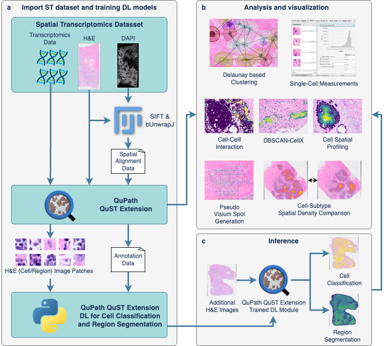

:html_theme.sidebar_secondary.remove:

QuST: Whole Slide Image and Spatial Transcriptomics Analysis in QuPath
======================================================================

QuST is a `QuPath <https://qupath.github.io>`_ extension that bridges whole slide images (WSI) and spatial transcriptomics
(ST) at the single-cell level. This documentation describes the components of QuST that are presented in the paper:

   Huang C-H, Lichtarge S, Fernandez D. *Integrative whole slide image and spatial transcriptomics analysis with QuST
   and QuPath.* npj Precision Oncology 9, 70 (2025). https://doi.org/10.1038/s41698-025-00841-9

.. caution::

  QuST is a research tool. It is not cleared for clinical workflows or patient-facing decisions.

The workflow of the paper (Fig. 1) has three parts: (a) the ST data are imported into QuPath, with an alignment of the ST data
to the H&E image for Xenium; (b) the data are analysed and visualised with QuPath and QuST; (c) the biological evidence of the
ST is used to generate the training sets for the image-based cell classification and region segmentation on H&E, and the
result of the deep learning module is analysed with the functions of (b).

.. toctree::
  :maxdepth: 2
  :caption: Contents:

  Installing <installing>
  Loading ST data and detecting cells <loading>
  Registration of ST data to the H&E image <registration>
  Cellular spatial profiling <spatial_profiling>
  Cellular neighborhood analysis <neighborhood>
  Cell-cell interaction analysis <cci>
  Cell clustering analysis (DBSCAN-CellX) <clustering>
  Pseudo spot generation <pseudo_spots>
  Deep learning: classification and segmentation <deep_learning>
  Measurements and classes <measurements>

Components
----------

All commands are under **Extensions → QuST Analysis Toolbox**.

.. list-table::
  :header-rows: 1
  :widths: 30 36 34

  * - Component of the paper
    - Commands
    - Page
  * - Single-cell level ST in the H&E image
    - 10x Xenium Annotation, NanoString CosMx Annotation, 10x Visium Annotation, the Image Registration Parameters of Xenium
      and Visium, StarDist Nucleus Detection, Cellpose Nucleus Detection
    - :doc:`loading`
  * - ST and WSI coordinate alignment (SIFT affine and B-spline)
    - ST2WSI Registration (Fiji plugin and QuPath command)
    - :doc:`registration`
  * - Cellular spatial profiling (Algorithm 1)
    - Delaunay Connections, Cell Spatial Profiling by Classification
    - :doc:`spatial_profiling`
  * - Cellular neighborhood analysis (Algorithm 2)
    - Neighboring Cell Type Composition
    - :doc:`neighborhood`
  * - Cell-cell interaction analysis (Algorithm 3)
    - Cell-Cell Interaction Analysis
    - :doc:`cci`
  * - Cell clustering analysis
    - DBSCAN-CellX
    - :doc:`clustering`
  * - Pseudo spot generation
    - Pseudo Spot Generation
    - :doc:`pseudo_spots`
  * - DL-based image classification and segmentation
    - Export Images for Object Classification, Object Classification, Export Images for Region Segmentation, Region
      Segmentation
    - :doc:`deep_learning`

Citing
------

Please cite the paper above and the `QuPath publication
<https://qupath.readthedocs.io/en/stable/docs/intro/citing.html>`_. DBSCAN-CellX is by Küchenhoff et al.
(*Sci Rep* 13, 18868, 2023); the ligand-receptor table is CellTalkDB (Shao et al., *Brief Bioinform* 22, bbaa269, 2021).

Licence
-------

GPL-3.0-or-later. The code builds on QuPath and on bUnwarpJ, which are GPL-licensed.
